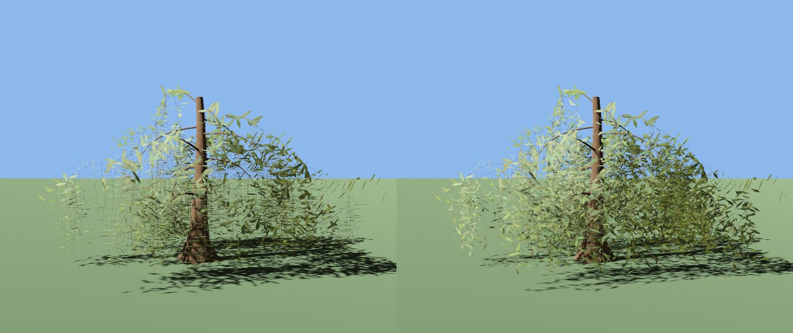

# Bark, leaves, wind and looks

What a tree is drawn with: its bark scan, its leaf cards and veins, the light on them, the wind through them, and the styles they are drawn in.

## Leaf shading and wind

Trees drawn by the plugin move in the wind, with no cost to the CPU per frame. `FloraWind` is a global resource: how hard (`strength`), which way (`direction`), how fast (`speed`), how far trees bend (`bend`), how much leaves flutter (`flutter`, `flutter_frequency`), how much the wind comes in gusts (`gust_strength`, `gust_frequency`) and sways across itself (`turbulence`). `TreeParams::wind` is how a species answers it, and the presets set their own: a willow or a palm moves more than an oak or a pine, and a shrub leans by about the same share of its own height as a tall tree, at whatever `Transform` scale or `FloraUnits` you draw it. A `GustFront` is a band of stronger wind that sweeps across the world:

```rust,no_run
use bevy::prelude::*;
use bevy_flora::{FloraWind, GustFront, TreePreset, WindResponse};

// Call this once, when the storm begins (from an event or a timer), not every frame: launching a
// gust restarts its front at `origin`.
fn start_storm(mut wind: ResMut<FloraWind>, time: Res<Time>) {
    wind.strength = 0.6; // 0 is calm, 1 a strong wind
    wind.direction = Vec2::new(1.0, 0.0); // blowing toward +x
    // A band of wind, 30 m deep, crossing the world along +x at 20 m/s from x = -50.
    wind.launch_gust(
        GustFront { origin: Vec2::new(-50.0, 0.0), speed: 20.0, ..default() },
        &time,
    );
}

fn stiff_willow() -> bevy_flora::TreeParams {
    let mut params = TreePreset::Willow.params();
    params.wind = WindResponse { sway: 0.4, ..default() };
    params
}
```

Changing `FloraWind` writes one small shared buffer (`FloraWindBuffer`) and touches no material, so you can animate it every frame (a storm that builds, a wind that turns): a pooled forest of 20 000 trees takes 3.3 ms a frame with the wind changing every frame, where 0.5 took 212 ms (Apple M4 Pro). Launching a gust front writes the same buffer. Wind writes no motion vectors, and branches do not sway on their own: the whole tree bends and the leaves flutter. Leaf shading and wind need storage buffers in the vertex stage; on a device without them (WebGL2) trees are drawn with plain materials and one warning says so.

## Bark

Trunks and branches wear a bundled CC0 bark scan (a colour map and a normal map, 512 px wide, about 3.1 MB for all 14). Each preset picks the scan of its species (`TreeParams::bark`); `BarkParams` sets how it follows the wood's growth. The scan is laid out in metres on the *mature* tree, so a growing tree's bark never slides; wood thinner than `smooth_below` is smooth, and by `fissured_above` it shows the whole scan, so a young branch gains relief as it thickens. The scan's average colour is divided out of the material's base colour, so a textured tree keeps its preset colour, and far trees, impostors and the plain `StandardMaterial` fallback look as they always did.

```rust,no_run
use bevy_flora::{BarkParams, BarkScan, TreePreset};

fn gnarled_oak() -> bevy_flora::TreeParams {
    let mut params = TreePreset::Oak.params();
    // Fissured sooner than the preset: smooth under 1 cm of radius, the whole scan from 8 cm.
    params.bark = BarkParams { scan: Some(BarkScan::Brown), smooth_below: 0.01, fissured_above: 0.08 };
    params
}

fn plain_pine() -> bevy_flora::TreeParams {
    let mut params = TreePreset::Pine.params();
    params.bark.scan = None; // flat colour, as before 0.7
    params
}
```

The textures are compiled in by the default `textures` feature (about 3.6 MB of JPEG for the bark and the leaf scans); with `default-features = false` every scan is absent, wood is plain colour and leaves keep their procedural outline. Their sources and licences (all CC0 1.0, no attribution required) are in [`src/textures/CREDITS.md`](../../src/textures/CREDITS.md).

## Leaves: real outlines and grown veins

Seven presets (oak, willow, birch, bonsai, maple, poplar and Japanese maple) cut their leaf cards to the real outline of a scanned leaf and wear it. `FoliageParams::scan` (`LeafScan`) picks one of seven bundled CC0 atlases of four photographed leaves each; every leaf is one of the four (chosen by a hash of its own random draws, which never change as the tree ages, so a leaf keeps its shape while the tree grows and on `GpuGrowth` too), the card is as wide as that leaf is, and its length is the leaf's `size`. The atlas's colour and normal maps are applied in the fragment shader and its average colour is divided out of the leaf colour, so a crown keeps its preset colour. Distant levels of detail cut the cards to a coarser outline.

Leaves with no scan (the other presets and any `TreeParams` of your own, since `scan` defaults to `None`) keep the procedural outline, and their veins are no longer a formula: a vein network is grown from the petiole toward auxin sources scattered over the card by space colonisation (Runions et al., SIGGRAPH 2005), widths by Murray's law, drawn into one small image that every such leaf shares (`bevy_flora::venation`; `LeafShading::veins` sets how strongly the shader draws them). Needle clusters and cluster spheres are not leaf-shaped and have none.

```rust,no_run
use bevy_flora::{LeafScan, TreePreset};

fn maple_with_oak_leaves() -> bevy_flora::TreeParams {
    let mut params = TreePreset::Maple.params();
    params.foliage.scan = Some(LeafScan::Oak);
    params
}

fn procedural_oak() -> bevy_flora::TreeParams {
    let mut params = TreePreset::Oak.params();
    params.foliage.scan = None; // the procedural leaf, with grown veins
    params
}
```

### A willow's curtain: the leaves of a strand



*`cargo run --release --example inspect -- --preset willow --mode pool --distance 14 --eye 2.5 --fov 40 --yaw 20`: left, 0.47.1; right, with strand leaves.*

A weeping tree is its strands (`BranchParams::strands`, [growing](growing.md)), and what a strand carries is `FoliageParams`' three strand numbers. `strand_density` is the share of `density` a strand's leaves have (a long thin twig has a row of leaves of its own spacing, not a branch's rate), `strand_size` the share of `leaf_size` they have, and `strand_angle` how far, in degrees, a strand's leaves point out of line with it: each leaf leaves its rope that far to the side that the golden angle's turn from the leaf before gives (spiral phyllotaxis), so the rope is a ribbon as wide as a leaf is long and not a wire with a leaf-wide trim. All three are 1, 1 and 0 for a tree that does not set them, which draws the leaves it always did, but every leaf of a strand is now cut as a four-point lance (the base, tip and two widest points of its scan's outline, wearing the same atlas): 8 vertices and 4 triangles for both sides where a scanned card has 20 and 16.

The turn is the thing: seen from the front and the side, a probe that rasterises every triangle of the mature willow over the lower third of its crown covered 0.335 and 0.271 of it in 0.47.1 (a fence, two thirds sky) and 0.585 and 0.509 now, at 0.552 and 0.475 at the coarsest level of detail, whose leaves are the same lances, kept one in eight and scaled up. Raising the rate alone moved nothing (2.6 times the leaves along the ropes, at 0.7 of their size, in line with them: 0.336), and the rate is held by the growth: a leaf eases in over the growth of rope the next leaf takes, so a denser strand flushes quicker. The willow's 1.4 times keeps every leaf from changing by more than 0.3 of its size in a 0.01-year step (`a_leaf_that_appears_grows_from_nothing`), and 3 times did not. The willow's foliage is 40 900 triangles, down from 74 100, because the new leaves are cheaper than the ones they replace; its build time barely moves (4.4 ms against 4.7 for the mature tree).

```rust,no_run
use bevy_flora::TreePreset;

fn a_fuller_curtain() -> bevy_flora::TreeParams {
    let mut willow = TreePreset::Willow.params();
    willow.foliage.strand_size = 1.1; // longer leaves on the ropes
    willow.foliage.strand_angle = 55.0; // standing further out of their line
    willow
}
```

## Looks: natural, painterly, toon

`TreeParams::style` (`RenderStyle`) changes how a tree is lit, not its shape; every preset is `Natural`. `Painterly` gives each leaf the normal that points out of the centre of its own clump (the leaves of one primary branch, the leader or one half of a split) instead of out of the crown's centre, so a crown reads as a cluster of rounded masses, each with a lit side and a shaded side; the lighting is the same physically based lighting as `Natural`. `Toon` keeps those normals, cuts the light of each directional light into three bands (0.15, 0.55 and 1 at `N·L` of 0 and 0.5) times its shadow and the surface colour, keeps the light that comes through backlit leaves, and darkens every surface toward its silhouette with an ink rim. Point and spot lights do not light a toon. Pools, impostors, `GpuGrowth` and growing trees draw them all; without the renderer's plugins (the plain-material fallback) a toon is lit as a painterly tree.

```rust,no_run
use bevy_flora::{RenderStyle, TreePreset};

fn painted_maple() -> bevy_flora::TreeParams {
    let mut params = TreePreset::Maple.params();
    params.style = RenderStyle::Painterly;
    params
}

fn toon_oak() -> bevy_flora::TreeParams {
    let mut params = TreePreset::Oak.params();
    params.style = RenderStyle::Toon;
    params
}
```

## Low-poly conifers: `CrownStyle::Hull` and `TrunkStyle::Prism`

A game that draws its forest as a few big flat planes does not want leaf cards. `TreeParams::crown` set to `CrownStyle::Hull { tiers, sides, lift, jitter, trunk_only }` draws the crown as one faceted hull instead: a stack of `tiers` cones of `sides` facets each, wrapped round the tree's leaf cloud (each cone as wide as the 90th percentile of the leaves in its band, never wider than the one below), `tiers * sides * 2` flat triangles in all. `lift` keeps the crown at least that share of the tree's height above the root, so a trunk shows under it and a body can walk beneath, and `jitter` (0 to 1) knocks the rings about so no two trees are the same. `TreeParams::trunk_style` set to `TrunkStyle::Prism { sides }` meshes the wood as flat-shaded prisms with that many faces. `trunk_only` (the low-poly look) draws the wood of a hull tree as its trunk chain only (the trunk and its leader: a few dozen triangles, no twig poking out of a facet); the skeleton keeps its branches, so felling, shape and fire are unchanged, and `false` draws every branch. Both default to leaf cards and a round trunk, which every preset keeps.

The hull is lit matte and flat: no veins, no light through it, no scan; snow lies on the facets that face up. It works through everything else a tree does: pools take it (the coarse levels keep `LodSettings::hull_detail` of its tiers and sides, default 1.0, 0.7 and 0.5, inside level 0's bounds), impostors bake it, a prism trunk is notched, felled and bucked, fire chars it and burns its facets away, and a shake or a landing sheds chips of it (96 small triangles in its facets' colours), not whole facets. Its colours and phases are fixed by the seed and the facet, so they never change as the tree grows. It is built on the CPU: `GpuGrowth` on such a tree is ignored with a warning (`TreeParams::gpu_growable`).

```rust,no_run
use bevy_flora::{CrownStyle, TreePreset, TrunkStyle};

// The spruce as a five-tier, seven-sided cone stack on a five-sided trunk.
fn winter_spruce() -> bevy_flora::TreeParams {
    let mut params = TreePreset::Spruce.params();
    params.crown = CrownStyle::Hull { tiers: 5, sides: 7, lift: 0.2, jitter: 1.0, trunk_only: true };
    params.trunk_style = TrunkStyle::Prism { sides: 5 };
    params
}
```

*`cargo run --release --example inspect -- --out target/hull --preset spruce --hull 5,7 --prism 5 --mode tree --season 0,0,1`: the stylised spruce under snow.*
